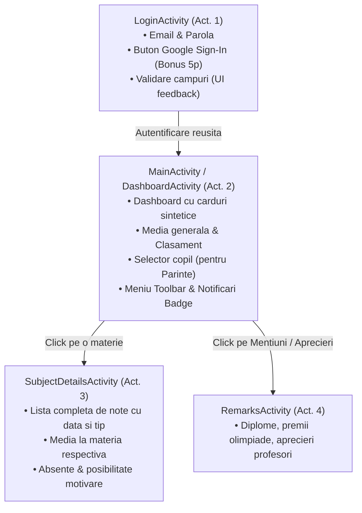

# 📱 Ghid de Implementare Frontend Android pentru EduGrade

Acest document contine planul arhitectural complet pentru dezvoltarea aplicatiei Android in Android Studio, astfel incat sa obtii **punctajul maxim (100 puncte + 10 puncte bonus)** conform baremului cerut de profesor.

---

## 🏗️ 1. Arhitectura Aplicatiei Android (Minim 3 Activitati)

Barem: *„sa fie compusa din cel putin doua activitati”* (10p)

Vom implementa 3 activitati principale, structurate curat si modular:



### Activitatea 1: `LoginActivity`
- Interfata de login moderna (Material 3: `TextInputLayout`, `TextInputEditText`).
- Buton de conectare cu email si parola (`POST /api/auth/login`).
- Buton de **Google Sign-In** (`POST /api/auth/google`) -> **Asigura bonusul de 5 puncte**!
- Salvare token JWT in `SharedPreferences` / `EncryptedSharedPreferences`.
- Validari in timp real (email valid, parola minim 8 caractere).

### Activitatea 2: `MainActivity` (sau `DashboardActivity`)
- Header cu avatar, numele utilizatorului si rolul (`ELEV` sau `PARINTE`).
- **Pentru Parinti**: Spinner / Dropdown orizontal cu copiii asociati (`Andrei Popescu`, `Elena Popescu`). La schimbarea selectiei, toate datele se actualizeaza automat!
- Card mare cu **Media Generala** (calculata automat de server) si numarul total de absente.
- `RecyclerView` cu materiile si mediile curente (`GET /api/grades/my-overview`).
- Contor vizual in toolbar cu notificarile necitite (`badge` rosu).

### Activitatea 3: `SubjectDetailsActivity`
- Se deschide la apasarea unei materii din lista din `MainActivity`.
- Afiseaza toate notele acordate (valoare, data, tip: test, teza, proiect, activitate).
- Afiseaza istoricul absentelor la acea disciplina (status: motivata/nemotivata).

---

## 🖱️ 2. Gestionarea Evenimentelor UI (Minim 2 evenimente)

Barem: *„sa utilizeze cel putin doua evenimente utilizator (ex., click si long click)”* (10p)

1. **Evenimentul 1 - Click (`setOnClickListener` / Item Click)**:
   - Apasarea pe un card de materie din lista deschide `SubjectDetailsActivity` trimitand `materie_id` prin `Intent.putExtra()`.
   - Apasarea pe clopotelul de notificari din Toolbar deschide un `BottomSheetDialogFragment` cu notificarile recente (nota noua, absenta consemnata).
2. **Evenimentul 2 - Long Click (`setOnLongClickListener`)**:
   - Apasare lunga pe o nota din lista: deschide un dialog cu detaliile complete ale evaluarii (profesorul care a acordat-o, data exacta, observatii: *„Test initial analiza”*).
   - Apasare lunga pe o absenta: pentru parinti/diriginti afiseaza optiunea de trimitere cerere de motivare sau vizualizare motiv scutire medicala.
3. **Eveniment aditional recomandat - Swipe-to-Refresh (`SwipeRefreshLayout`)**:
   - Trage in jos lista pentru a reincarca datele din cloud.

---

## 📋 3. Meniu Functional

Barem: *„sa aiba un meniu functional”* (10p)

Implementat in `res/menu/main_menu.xml` si gestionat in `onCreateOptionsMenu` / `onOptionsItemSelected`:

1. **Item 1: Notificari** (iconita clopotel cu `badge`): afiseaza lista de alerte primite din cloud.
2. **Item 2: Filtrare Note** (Toate, Nota >= 8, Note sub 5): filtreaza local lista din `RecyclerView`.
3. **Item 3: Comutare Copil** (pentru parinti - dialog rapid de selectie intre Andrei si Elena).
4. **Item 4: Deconectare (`Logout`)**: sterge tokenul din `SharedPreferences` si redirectioneaza catre `LoginActivity`.

---

## ☁️ 4. Stocare Date (Cloud: 20 puncte)

Barem: *„Stocare date: local 10 puncte / cloud 20 puncte”*

- Backend-ul **EduGrade** ofera persistenta 100% in cloud (baza de date relationala, tabele de asocieri, calcul dinamic).
- In Android, comunicarea se face prin **Retrofit 2** + **OkHttp 3** + **Gson/Moshi**.
- Se poate adauga optional un cache local cu **Room Database** sau `SharedPreferences` pentru functionare offline (obtinand atat cloud 20p cat si robustete offline).

---

## 🔌 5. Configurare Retrofit in Android Studio

### 1. Dependinte `build.gradle (Module: app)`:
```groovy
dependencies {
    // Retrofit & Gson
    implementation 'com.squareup.retrofit2:retrofit:2.9.0'
    implementation 'com.squareup.retrofit2:converter-gson:2.9.0'
    implementation 'com.squareup.okhttp3:logging-interceptor:4.11.0'

    // Material Components
    implementation 'com.google.android.material:material:1.11.0'
    implementation 'androidx.swiperefreshlayout:swiperefreshlayout:1.1.0'

    // Google Sign-In (pentru Bonus 5p)
    implementation 'com.google.android.gms:play-services-auth:21.0.0'
}
```

### 2. URL de conectare (Emulator vs Dispozitiv Real):
- **Emulator Android Studio**: foloseste `http://10.0.2.2:8000/api/`
- **Telefon fizic conectat prin Wi-Fi**: foloseste IP-ul calculatorului, de exemplu `http://192.168.1.X:8000/api/` (sau un tunel `ngrok http 8000`)

### 3. Interfata `EduGradeApiService.java` / `.kt`:
```kotlin
interface EduGradeApiService {
    @POST("auth/login")
    suspend fun login(@Body req: LoginRequest): Response<TokenResponse>

    @POST("auth/google")
    suspend fun loginWithGoogle(@Body req: GoogleAuthRequest): Response<TokenResponse>

    @GET("auth/me")
    suspend fun getProfile(@Header("Authorization") token: String): Response<UserProfileResponse>

    @GET("grades/my-overview")
    suspend fun getMyOverview(
        @Header("Authorization") token: String,
        @Query("student_id") studentId: Int? = null
    ): Response<StudentAcademicOverview>

    @GET("parent/children")
    suspend fun getChildren(@Header("Authorization") token: String): Response<List<ChildSummary>>

    @GET("absences")
    suspend fun getAbsences(
        @Header("Authorization") token: String,
        @Query("student_id") studentId: Int? = null
    ): Response<AbsenceSummary>

    @GET("remarks")
    suspend fun getRemarks(
        @Header("Authorization") token: String,
        @Query("student_id") studentId: Int? = null
    ): Response<List<RemarkResponse>>

    @GET("notifications")
    suspend fun getNotifications(@Header("Authorization") token: String): Response<List<NotificationResponse>>

    @GET("dashboard")
    suspend fun getDashboard(
        @Header("Authorization") token: String,
        @Query("student_id") studentId: Int? = null
    ): Response<DashboardSummary>
}
```

---

## 🌟 6. Puncte Bonus (Max 10 puncte)

1. **Autentificare Google (5 puncte bonus)**:
   - Apel la `GoogleSignInClient` in Android.
   - Trimitere token obtinut catre `POST /api/auth/google`. Serverul genereaza automat contul sau il autentifica pe cel existent.
2. **Cresterea complexitatii / Statistici & Senzori (5 puncte bonus)**:
   - Integrare senzor de amprenta / biometrie (`BiometricPrompt`) pentru deblocare rapida a catalogului.
   - Grafice de evolutie a mediilor folosind libraria `MPAndroidChart` pe baza datelor din `GET /api/grades/my-overview`.
